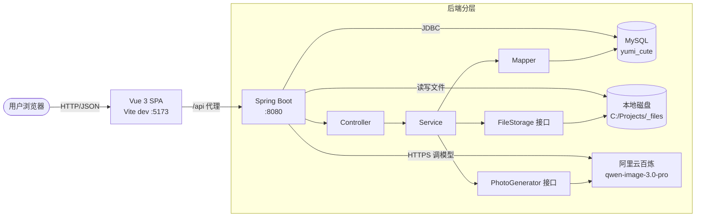

# YuMi-cute · 人宠写真 AI 生成平台

> 让把宠物当家人的主人，用一顿饭的钱，为自己和它留下一套写真。

YuMi 取自家人的昵称「玉米」。这不是一份练手作业，是为真实的人做的产品 ——
完整的产品定义与取舍见 [PRODUCT.md](PRODUCT.md)。

---

## 效果

<!-- TODO: 放 2~3 张真实生成结果（一套里的不同构图），这是整份 README 最重要的部分 -->

| 日系清新 | 国风工笔 | 咖啡馆日常 |
|---|---|---|
| _（待补充）_ | _（待补充）_ | _（待补充）_ |

---

## 核心机制：先试后买

传统 AI 写真和写真馆都是「先付费、后交付」，全部不确定性由用户承担。

YuMi-cute 把这个顺序倒过来：

```
上传本人照片 + 宠物照片
        ↓
选择风格模板（8 套官方预设）
        ↓
先出一张试看（整套价的 1/4）
        ↓
  满意 → 生成整套 6 张
不满意 → 换风格，重新试看
```

这一个机制同时解决两件事：

- **对用户**：拆掉「怕花冤枉钱」这个最大的心理障碍
- **对系统**：订单天然成为状态机（试看单 → 整套单），业务复杂度真实存在

---

## 技术栈

| 层 | 选型 |
|---|---|
| 后端 | Spring Boot 4.0.8 / Java 21 / MyBatis（注解 SQL）/ MySQL 9 |
| 前端 | Vue 3 / Vite / Pinia / vue-router / **Tailwind CSS v4** / 自建基础组件 |
| AI | 阿里云百炼 `qwen-image-3.0-pro`（图生图，**一次调用出整套**） |
| 工程 | ESLint + Prettier / Playwright（自动截图） |

---

## 架构



**两处关键抽象**（换模型、换存储都不用改业务代码）：

- `PhotoGenerator`：`MockPhotoGenerator`（本地开发，不花钱） / `AiPhotoGenerator`（真 AI），由 `ai.provider` 切换
- `FileStorage`：`LocalFileStorage`（本地磁盘），将来可换成 OSS / MinIO

---

## 快速开始

### 前置条件

- JDK 21+
- Node.js 22+
- MySQL 8+（本项目在 MySQL 9.7 上验证）

### 1. 建库并导入数据

```bash
mysql -uroot -p --default-character-set=utf8mb4 < sql/schema.sql
mysql -uroot -p --default-character-set=utf8mb4 yumi_cute < sql/data.sql
```

> **`--default-character-set=utf8mb4` 不能省。**
> Windows 上的 mysql 客户端默认用控制台编码（GBK）作为连接字符集，
> 导入含中文的 SQL 时会报 `ERROR 1366: Incorrect string value`，或者静默存成乱码。
> 两个 SQL 文件里也加了 `SET NAMES utf8mb4;` 作为双保险。

`schema.sql` 由 mysqldump 从运行中的库导出，包含全部 7 张表和 5 个唯一索引。
`data.sql` 提供 8 套风格模板 —— **没有它首页是空的，无法下单**。

### 2. 启动后端

```bash
cd backend/yumi-cute-backend
./mvnw spring-boot:run
```

默认监听 `http://localhost:8080`。

### 3. 启动前端

```bash
cd frontend
npm install
npm run dev
```

打开 `http://localhost:5173`（Vite 会把 `/api` 代理到 8080）。

### 4. 注册一个账号

新用户注册赠送 **100 算力**，够跑几次试看单。

---

## 环境变量

后端启动前可按需设置（都有开发用默认值，但**生产环境必须替换**）：

| 变量 | 必需 | 说明 |
|---|---|---|
| `AI_PROVIDER` | | `mock`（默认，不调真模型、不花钱）/ `dashscope`（真 AI） |
| `DASHSCOPE_API_KEY` | 用真 AI 时必需 | 阿里云百炼 API Key |
| `AI_BASE_URL` | 用真 AI 时必需 | 业务空间专属域名，形如 `https://{WorkspaceId}.cn-beijing.maas.aliyuncs.com/compatible-mode/v1` |
| `AI_MODEL` | | 默认 `qwen-image-3.0-pro` |
| `JWT_SECRET` | 生产必需 | JWT 签名密钥（有开发默认值，上线必须换） |
| `FILE_SIGN_SECRET` | 生产必需 | 文件访问签名密钥（同上） |
| `DB_USERNAME` / `DB_PASSWORD` | | 数据库账号，默认 `root` / `yumi123456` |
| `FILE_STORAGE_PATH` | | 文件存储根目录，默认 `C:/Projects/_files` |
| `FILE_REF_TTL_DAYS` | | 参考图在订单结束后保留几天，默认 `7` |

> **只想跑通流程、不想花钱**：保持 `AI_PROVIDER=mock` 即可。
> Mock 生成器会把用户上传的原图当作结果返回，用来验证订单状态机、算力扣减、异步分派这些业务逻辑。

---

## 接口一览

| 方法 | 路径 | 说明 |
|---|---|---|
| POST | `/user/register` | 注册（赠送算力） |
| POST | `/user/login` | 登录，返回 JWT |
| GET | `/user/me` | 当前用户信息 |
| PUT | `/user/avatar` | 更换头像 |
| POST | `/file/upload` | 上传图片，返回带短时签名的地址 |
| GET | `/style/list` | 风格模板列表（免登录） |
| POST | `/order/create` | 下单，返回订单号（**带幂等键**） |
| GET | `/order/list` | 我的订单 |
| GET | `/order/detail/{id}` | 订单详情（含每张图的生成状态） |

除 `/user/login`、`/user/register`、`/style/list` 外，所有接口都需要 `Authorization: Bearer <token>`。

---

## 几个值得看的工程细节

这个项目里真正花力气的地方，不在"能出图"，而在这几处：

- **一次调用出整套**：实测 `n=6` 只比 `n=1` 慢几秒，而串行 6 次是 6 倍时间 —— 所以 `n` 由订单张数驱动，整套写真一次出完。
- **钱的一致性**：扣费与建单同事务；退款与状态写入同事务（退款失败会回滚状态，交由补偿任务接管）；幂等同时依赖 `finish()` 的条件更新和数据库唯一索引两道防线。
- **时钟同源**：所有涉及时间的比较都在 SQL 里用 `NOW()` 完成，避免 JVM 与 MySQL 时区不一致导致的"订单刚下单就被判超时"。
- **文件访问控制**：`` 带不了 `Authorization` 头，所以静态资源改用 URL 短时签名；签名与路径绑定，换路径或改过期时间都会失效。
- **原图用完即删**：参考图在订单结束后 7 天自动清理，作品永久保留；详情页对已清理的原图显示占位而不是破图。

---

## 已知限制

- **支付是模拟的**，没有接真实支付（真实支付需要企业资质与备案）
- **没有充值入口**，算力只能靠注册赠送
- **生成任务用线程池而非消息队列**，进程重启会丢掉已投递的任务（靠补偿任务兜底，属于最终一致而非可靠投递）
- **单实例部署**：补偿任务用 `@Scheduled`，多实例下会重复扫描（虽有条件更新兜底，但会浪费资源）
- **前端靠 2 秒轮询**，没有做 SSE / WebSocket

---

## 文档

- [PRODUCT.md](PRODUCT.md) —— 产品定义：为谁做、解决什么、明确不做什么
- [docs/FRONTEND.md](docs/FRONTEND.md) —— 前端设计规范：色板、间距、组件用法、错误处理约定
- [docs/PITFALLS.md](docs/PITFALLS.md) —— 踩坑记录：31 条，分环境 / 数据库 / 后端逻辑 / 前后端联调 / 安全 / 设计理念六类
