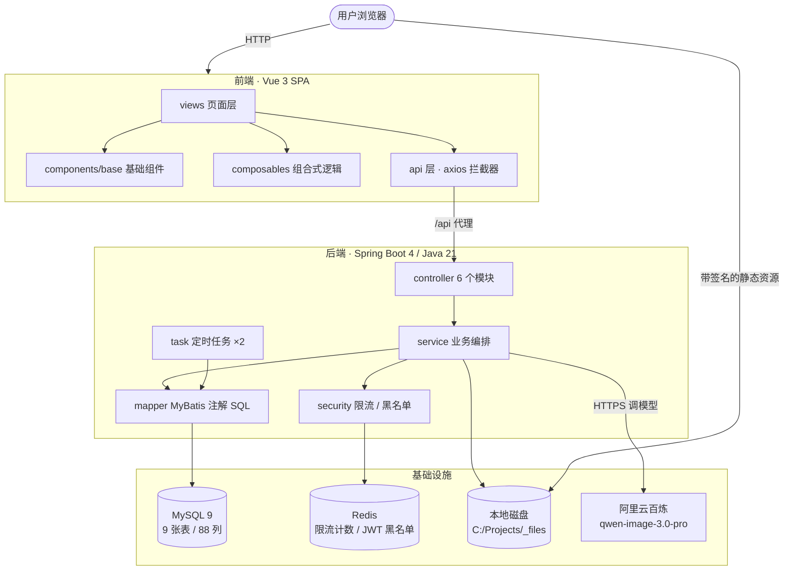

# 架构说明

> 本文描述 YuMi-cute 当前的系统结构、关键链路、技术决策与已知边界。
> 产品定义见 [PRODUCT.md](../PRODUCT.md)，前端规范见 [FRONTEND.md](FRONTEND.md)，
> 踩坑记录见 [PITFALLS.md](PITFALLS.md)。

---

## 1. 系统全景



**两个关键抽象**（换实现不动业务代码）：

| 接口 | 现有实现 | 将来可替换为 |
|---|---|---|
| `PhotoGenerator` | `MockPhotoGenerator` / `AiPhotoGenerator` | 其它模型厂商 |
| `FileStorage` | `LocalFileStorage` | OSS / MinIO |

---

## 2. 技术栈与选型理由

| 层 | 选型 | 为什么 |
|---|---|---|
| 后端框架 | Spring Boot 4.0.8 / Java 21 | 主流、生态完整；21 的记录类与文本块减少了大量样板 |
| ORM | MyBatis（**注解 SQL**） | SQL 完全可控，便于做条件更新、唯一索引兜底这类"靠数据库保证正确性"的设计 |
| 数据库 | MySQL 9 | 唯一索引、事务、`DATE_ADD` / `DATE_SUB` 是资金与时序正确性的基础设施 |
| 缓存 | Redis（StringRedisTemplate + Lua） | 限流计数与 token 黑名单都是"有 TTL 的临时状态" |
| 前端 | Vue 3 / Vite / Pinia / vue-router | 组合式 API 便于把逻辑抽成 composable |
| 样式 | Tailwind CSS v4 + 自建设计 token | 视觉一致性由 token 保证，组件可完全自控 |
| 鉴权 | JWT（含 `jti`）+ 短时 HMAC 签名 | 两种凭证解决两种问题，见 §6 |
| AI | 阿里云百炼 `qwen-image-3.0-pro` | 图生图，一次调用出整套 |

---

## 3. 分层与模块职责

```
controller   6 个：user / file / style / order / recharge / share
service      9 个：业务编排（OrderService、RechargeService、ShareService、
                    DownloadService、GenerationService、OrderRefundService…
service      另有：FileService、UserService、StyleTemplateService）
mapper       8 个：全部注解 SQL，无 XML
security     2 个：LoginAttemptService（限流）、TokenBlacklistService（吊销）
interceptor  2 个：JwtInterceptor（登录态）、FileAccessInterceptor（文件签名）
storage      2 个：FileStorage 接口 + LocalFileStorage
generator    3 个：PhotoGenerator 接口 + Mock / Ai 实现
task         3 个：卡单补偿、文件清理、充值超时关闭
```

**分层原则**：

- Controller 只做"取当前用户 + 调服务 + 包结果"，不写业务
- Service 持有事务边界，**一个方法 = 一个业务动作**
- Mapper 里凡是有并发风险的写操作，一律写成**带条件的 UPDATE**

---

## 4. 数据模型

| 表 | 作用 | 关键约束 |
|---|---|---|
| `user` | 账号与算力余额 | `uk_username` |
| `pet` | 宠物档案（暂未启用） | — |
| `style_template` | 风格模板 | — |
| `photo_order` | 写真订单 | `uk_order_no`、`uk_client_token(user_id, client_token)`、`uk_share_token` |
| `photo_task` | 每张图的生成任务 | — |
| `points_record` | **算力流水（钱的唯一真相）** | `uk_user_type_biz(user_id, type, biz_id)` |
| `user_file` | 文件属主与生命周期 | `uk_url` |
| `recharge_package` | 充值套餐 | — |
| `recharge_order` | 充值订单 | `uk_recharge_no`、`uk_client_token(user_id, client_token)` |

**设计要点**：

- `points_record` 是**账务的单一真相**：`user.points` 必须恒等于该用户所有流水之和，差额只能靠补记调整流水来抹平，**不允许直接改余额**
- `photo_order` / `recharge_order` 都持有**下单时的金额与算力快照**，套餐改价不影响历史订单
- 所有"删除"都是**软删**（`deleted_at`），记录保留以便审计与对账

---

## 5. 四条关键链路

### 5.1 下单

```
前端生成 clientToken（一次购买意图一个）
  → 风格校验 / 归属校验
  → 原子扣算力（UPDATE ... WHERE points >= cost）
  → 插入订单（client_token 唯一键）
  → 批量插入 N 条任务
  → 记消费流水
[同一事务]  提交后异步触发生成
```

重复提交命中唯一键 → **事务整体回滚（扣费一并撤销）** → 回查原单号返回。

### 5.2 生成

```
@Async 线程
  → 订单状态 0/1 → GENERATING（条件更新抢占）
  → 调 PhotoGenerator：一次调用拿回 N 张
  → 逐条任务标记成功 / 失败（单条失败不带崩循环）
  → 写订单终态 + 按结果退款（同一事务）
```

**补偿任务**每 60 秒扫「卡在 0/1 且超过 N 分钟」的订单，判失败并全额退款。

### 5.3 充值

```
下单 → 状态 0（待支付），快照金额与到账算力
  → 支付回调：条件更新 0→1（抢处理权）
  → 加算力 + 记流水 + 置 2（同一事务）
```

回调重复到达时条件更新返回 0，直接返回 `0`（本次未到账），**不抛异常**——重复回调是正常现象。

### 5.4 退款

```
订单终态 → finalizeOrder（同一事务）
  → 抢终态写权限（finish 带 status IN (0,1) 条件）
  → 按终态算退款：全部失败全额 / 部分失败按失败张数比例 / 成功不退
  → 加算力 + 记流水
```

**退款失败会让状态回滚**，订单留在中间态由补偿任务接管 —— 系统能自愈。

---

## 6. 技术亮点（每条都是"问题 → 方案 → 代价"）

### 6.1 幂等：三道防线而不是一把锁

| 防线 | 位置 | 作用 |
|---|---|---|
| 条件更新 | `UPDATE ... WHERE status = 0` | 抢处理权，返回 1 才继续 |
| 唯一索引 | `points_record.uk_user_type_biz` | 重复入账被数据库拒绝 |
| 同一事务 | 状态 + 资金 | 不存在"状态改了钱没到" |

**代价**：事务略长；但换来自愈能力（失败回滚 → 补偿接管）。

### 6.2 跨时钟比较：把时间运算全部下推给数据库

**问题**：JVM 时区 +08:00、MySQL 会话时区 UTC，用 Java 的时间与数据库的时间比较，会把"刚下单"判成"已超时"。

**方案**：凡是涉及时序判断与时间写入，一律用 SQL 内的 `NOW()` / `DATE_ADD()` / `DATE_SUB()`，两端同源。

**代价**：SQL 里出现了业务时间逻辑；但这是唯一可靠的做法。

### 6.3 静态资源鉴权：短时 HMAC 签名

**问题**：`` 无法携带 `Authorization` 头。

**方案**：URL 携带 `exp` + `sig`，`sig = HMAC(路径 + exp)`。与路径绑定，**换路径、改过期时间、换用户都无效**。

**代价**：签名不可撤销（要撤销得引入有状态凭证，见 6.4）。

### 6.4 分享：有状态凭证与无状态签名分离

- **文件签名**：无状态，用于「证明你有权看」
- **分享 token**：存库、可撤销、7 天过期，用于「我授权给谁看」

**两者不能互相替代**：拿分享 token 去当文件签名必须失败（已验证）。

### 6.5 Redis 的两处真实用途

| 用途 | 关键技术点 |
|---|---|
| 登录限流 | **Lua 脚本原子完成「INCR + PEXPIRE」**；分开写时进程崩了会让 key 永不过期，账号被永久锁定 |
| JWT 吊销 | 签发带 `jti`，登出写黑名单，**TTL = token 剩余有效期**，无需清理任务 |

**为什么钱不进 Redis**：Redis 是"可丢的加速层"，余额是"不可丢的真相"。

### 6.6 文件生命周期

参考图在订单结束后 7 天自动清理，作品永久保留。删除订单时：

- 先判断文件**是否被其他未删除订单共用**（`user_file` 按 URL 唯一，同一张参考图可能被多单复用）
- 未被共用才置为"立即到期"，由清理任务物理回收
- **先删磁盘再标记**，失败不标记以便下轮重试

### 6.7 AI 调用工程化

- **一次调用出整套**（`n = 张数`），而不是串行 N 次
- 只对 **429 / 5xx / 网络异常** 重试，业务错误不重试
- 读超时 10 分钟（图像生成慢），连接超时 15 秒
- 失败按**成功张数比例**退款

### 6.8 订单与充值的状态机

```
订单  0 待生成 → 1 生成中 → 2 完成 / 3 部分失败 / 4 失败 / 5 取消
充值  0 待支付 → 1 已支付 → 2 已到账 / 3 已关闭
```

所有状态流转都是**带前置状态条件的 UPDATE**，返回 1 才算抢到处理权。

---

## 7. 已知限制

| 限制 | 说明 |
|---|---|
| **测试只覆盖纯逻辑** | 33 个单测（退款计算 / 文件签名 / 下载命名）；Service 与 DAO 层无集成测试，端到端靠 Postman 集合 + SQL 对账 |
| **单机部署** | 定时任务无分布式锁；多实例会重复扫描（虽有条件更新兜底） |
| **本地磁盘存储** | `FileStorage` 已抽象，切换 OSS 只需新增实现类 + 调整签名来源 |
| **异步任务用线程池** | 进程重启会丢投递，靠补偿任务兜底（最终一致，非可靠投递） |
| **支付是模拟的** | 无真实支付渠道 |
| **无内容审核** | 用户上传与 AI 生成结果均未过审；国内上线是硬门槛 |
| **无压测数据** | 未做压测，但关键查询已做 EXPLAIN 审计并补齐索引（见 §7.1） |
| **改密码不会让旧 token 全局失效** | 需要 `token_version` 或 `pwd_changed_at` 机制 |

### 7.1 已完成的索引审计

| 查询 | 修复前 | 修复后 |
|---|---|---|
| 卡单补偿（每 60s 跑一次） | `possible_keys = NULL`，**扫全表** | 新增 `idx_status_id (status, id)`，只扫在途订单 |
| 任务按订单查（详情页每 2s 轮询） | `idx_order_id` 命中后仍需 filesort 排序 `seq_no` | 换成 `idx_order_seq (order_id, seq_no)`，filesort 消失 |

> 卡单补偿仍有小规模 filesort（`status IN (0,1)` 是两个区间，MySQL 需合并排序），
> 但候选集只是"在途订单"这几行，成本可忽略 —— 核心的"全表扫"已消除。
>
> 另外两处扫描**有意不修**：按 `biz_id` 查流水只在对账 SQL 里手工用（代码里只有 insert），
> 上传配额计数在当前代码里没有调用点。

---

## 8. 演进路线：从工具到社区

**现在**是"写真工具"，目标是**宠物社区**。路线与每阶段的技术前置：

| 阶段 | 内容 | 需要新增的技术 |
|---|---|---|
| **1（当前）** | 人宠写真工具 | — |
| **2** | **作品广场**：把私密分享变成公开列表 + 点赞 | 内容审核（UGC 合规硬门槛）、分页/游标、图片 CDN |
| **3** | 动态 / 关注 / 个人主页 | 关注关系表、信息流推送、Redis 热度排序 |
| **4** | 商家入驻 / 商品 | 多角色权限、订单体系扩展 |
| **5** | 宠物医院等线下合作 | 预约、地理位置 |

**架构上的两条原则**：

1. **不为未想清楚的产品提前设计架构**（过度设计）
2. 但要让「写真」保持为**独立能力**：加作品广场时，只新增 `post` / `comment` 表与新接口，**不修改 `photo_order` 与 `GenerationService` 的逻辑** —— 达到这个标准，边界就对了

**社区会带来的真实变化**（必须提前知道）：

- 流量形态从"低频下单"变成"高频浏览" → **本地磁盘与服务器带宽会成为瓶颈**，OSS + CDN 从"可选"变"必需"
- 内容从"用户私产"变成"公开 UGC" → **内容审核、举报、封禁**成为合规必需项
- 数据从"订单"变成"信息流" → 需要**分页、搜索、热度排序**，可能引入 Elasticsearch
